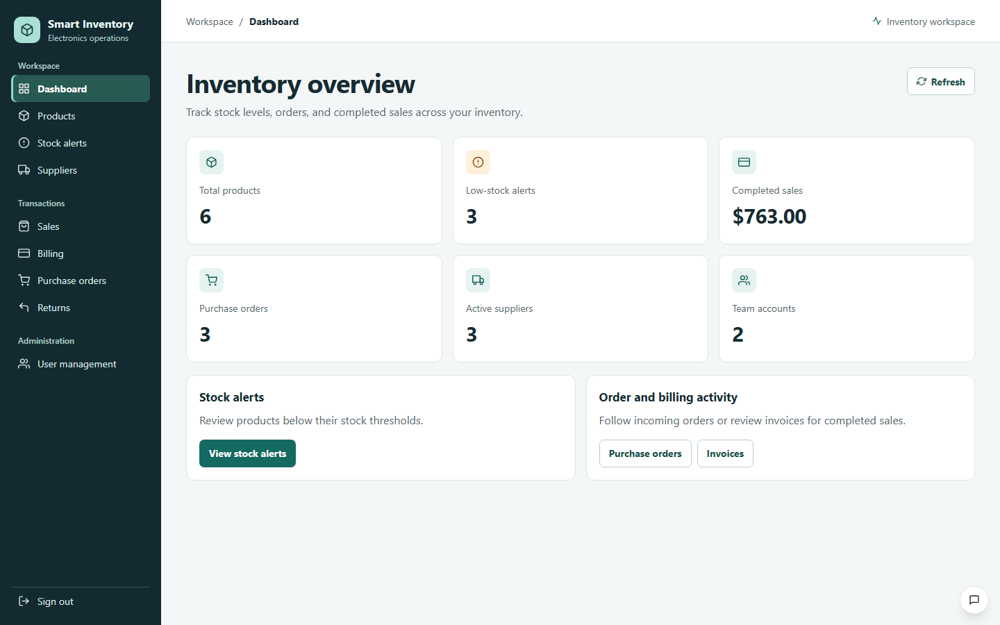
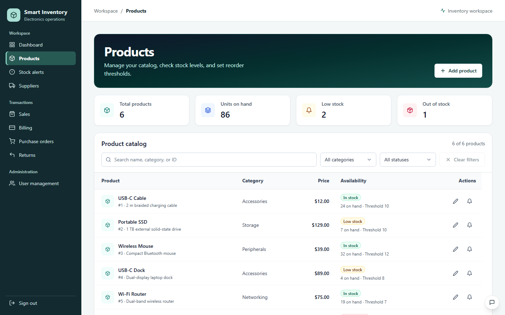

# Smart Inventory

An electronics inventory app built with React, Express, and MySQL. It brings the product catalog, stock thresholds, suppliers, sales, invoices, purchase orders, and returns into one workspace.

[Browse the application source on `master`](https://github.com/Abhyuday0404/Electronics_Inventory_Mangement_withAI/tree/master)

## Screenshots

The screenshots show the local application with sample inventory.

### Dashboard

Track inventory totals and jump to stock alerts, orders, or billing.

### Product catalog

Search the catalog and filter products by category or stock status.

### Sign-in

## Stack

- **Frontend** · React, Vite, React Router, Tailwind CSS
- **Backend** · Node.js, Express, MySQL
- **Inventory assistant** · Gemini text-to-SQL with translation support
